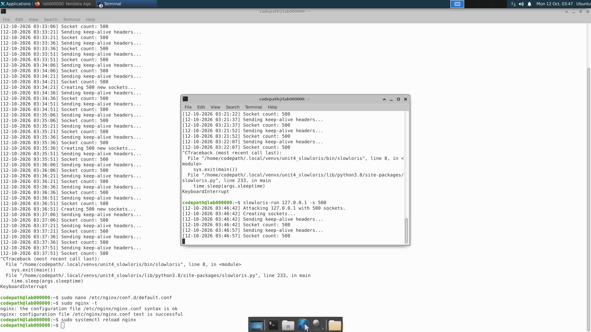
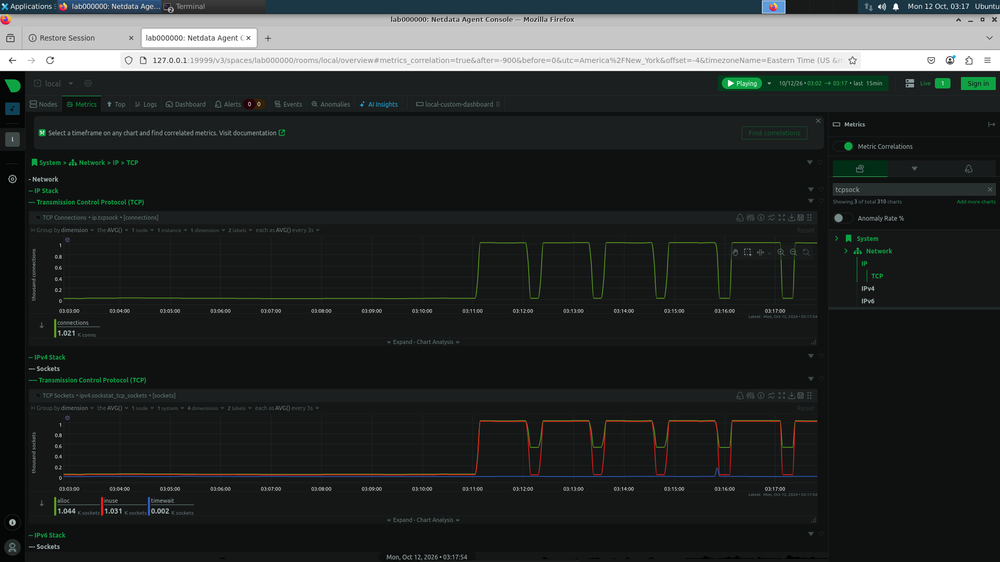
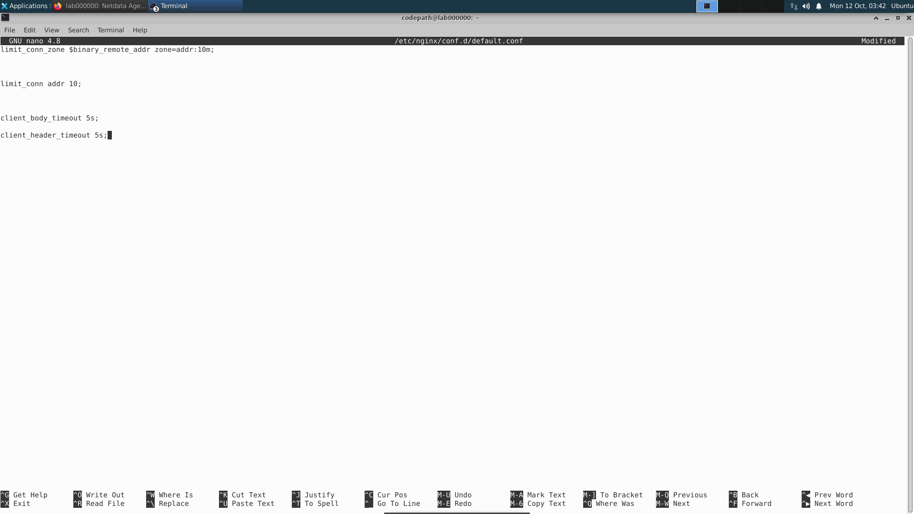
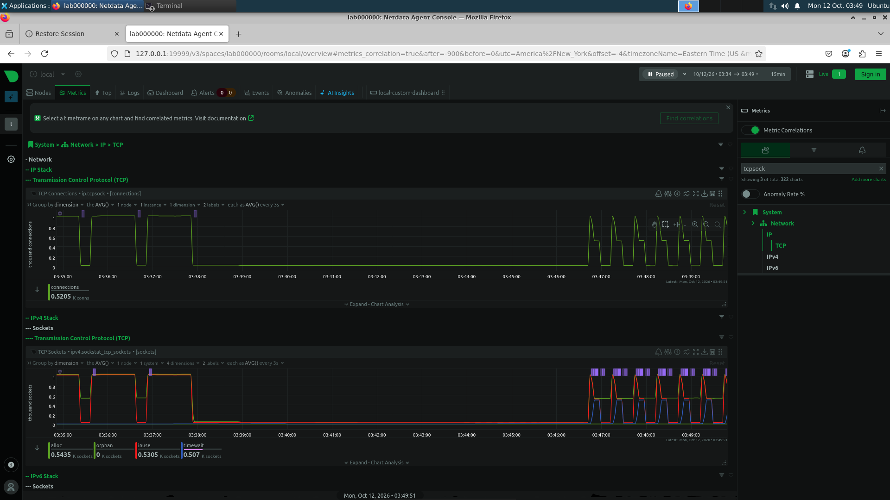

# NGINX Connection Exhaustion Defense 🛡️

## Project Overview

This project demonstrates how I **simulated, monitored, mitigated, and validated** a Slowloris application-layer Denial-of-Service attack against an NGINX web server in an authorized cybersecurity lab environment.

I executed a **500-socket Slowloris attack**, monitored TCP connection behavior using **Netdata**, implemented NGINX connection-limiting and timeout controls, and repeated the attack to evaluate the effectiveness of the mitigation.

---

## Technologies Used

**NGINX • Ubuntu Linux • Netdata • Slowloris • TCP/IP • Linux Terminal**

---

## 1. Slowloris Attack Simulation

I **executed** a 500-socket Slowloris attack against the local NGINX web server to simulate a connection-exhaustion attack.



---

## 2. Unprotected Server Behavior

Before implementing mitigation controls, I **monitored** TCP connections in Netdata.

The attack caused a significant increase in concurrent TCP connections, demonstrating how Slowloris can consume server resources by keeping incomplete HTTP connections open.



---

## 3. NGINX DoS Mitigation

I **configured** NGINX to restrict concurrent connections and terminate slow or incomplete HTTP requests more aggressively.

```nginx
limit_conn_zone $binary_remote_addr zone=addr:10m;

limit_conn addr 10;

client_body_timeout 5s;
client_header_timeout 5s;
```

I then **validated** the configuration before applying it:

```bash
sudo nginx -t
```

After successful validation, I **reloaded** NGINX:

```bash
sudo systemctl reload nginx
```



---

## 4. Protected Server Behavior

I **reran** the same 500-socket Slowloris attack after implementing the NGINX mitigation controls.

Netdata showed repeated connection drops as NGINX **terminated** slow and incomplete connections more aggressively instead of allowing them to remain continuously open.



---

## 🎥 Netdata Demonstrations

### Slowloris / Netdata Monitoring Demo

▶️ **[Watch Netdata Slowloris Mitigation Demo](./05-netdata-slowloris-mitigation-demo.mov)**

### Protected Server Demo

▶️ **[Watch Protected Slowloris Netdata Demo](./06-protected-slowloris-netdata-demo.mov)**

---

## Results

The unprotected test demonstrated that Slowloris could maintain a large number of concurrent connections against the server.

After I **implemented** NGINX connection limits and 5-second request timeouts, the server **terminated** slow connections more aggressively, reducing the attacker's ability to continuously hold server resources.

---

## Skills Demonstrated

- Application-Layer DoS Analysis
- Slowloris Attack Simulation
- NGINX Security Configuration
- TCP Connection Monitoring
- Netdata Security Monitoring
- Linux Administration
- Security Control Implementation
- Security Control Validation
- Defensive Security Testing
- Technical Documentation

---

## Key Takeaway

This project reinforced an important defensive-security workflow:

### **Detect → Analyze → Mitigate → Test → Validate**

Security is not only about identifying malicious activity. Effective defense also requires **implementing controls, testing those controls, and validating that they reduce risk.**
